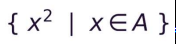

# Comprehension
## 초기화(List, Set, Dictonary)
```text
⚠️()로 표기하는 Tuple은 Generator Expression (제너레이터 표현식) 

수학의 집합 표기법과 닮은 구조를 띔
```

```
✔️기본 형태 (필터링 ❌)
    [값 for 변수 in 반복가능객체] 

✔️조건문 포함 형태 (if필터링)
    ○ 뒤쪽 if (값을 고르는 필터)
        [값 for 변수 in 반복가능객체 if 조건식] 
    ○ 앞쪽 if else (값을 바꾸는 변환)
        [값 if 조건식 else 값 for 변수 in 반복가능객체]

✅ 필터, 변환 함께 사용 가능 ⚠️복잡한 컴프리헨션 보단 일반 for문을 쓸 것
✅ 여러 개의 조건 사용 가능 
```