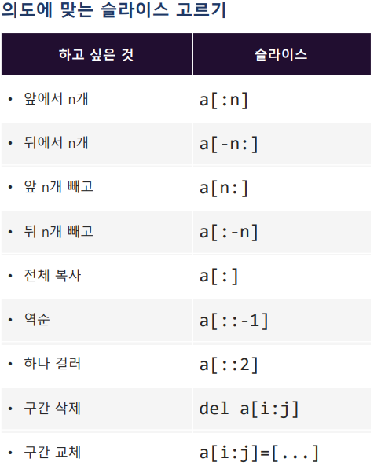

# Slicing
## Read (List, Tuple, String, Range)
```text
자료구조 [start: stop: step]

⚠️ 주의사항
슬라이싱의 결과는 원본 수정❌ 
➡️ 새 자료구조 반환

✔️ Step의 부호가 방향을 정한다
-   양수: 정방향 
-   음수: 역방향

생략시 기본 값에 따라 방향이 달라짐
    양수
    start 생략 -> 처음
    end 생략 -> 끝

    음수 
    start 생략 -> 끝
    end 생략 -> 처음

⚠️ 
start가 stop보다 앞에 있는데 step이 음수면 이동할 수 없어 결과는 빈 자료구조가 된다

✅
인덱스는 "칸 사이의 경계선" 이라고 생각

⭐
1) start 포함, stop 생략 -> 결과 길이 = stop - start

2) 범위 밖 인덱스 사용에도 Error ❌ -> 빈 자료구조 반환

3) 결과는 항상 새 자료구조
    원본 유지

4) step의 부호에 따라 방향이 결정
```
