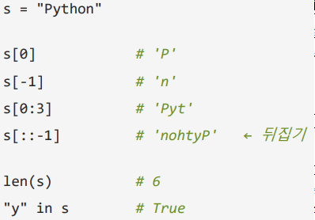
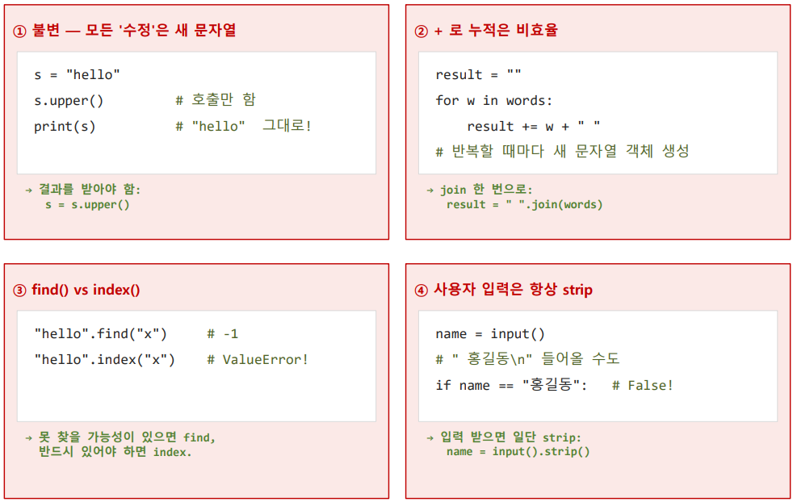

# String
```text
- String 
1) Sqeuence of Characters (문자의 시퀀스)
    list와 동일하게 indexing, slicing 가능
2) Immutable (불변)
    추가, 수정, 삭제 불가능 (Tuple과 동일)
3) 연결과 반복
    + 연결, * 반복 -> 새 문자열 생성
4) 많은 메서드
    모두 새 문자열 반환(원본은 불변, Read 동작)
5) 딕셔너리 key로 사용 가능
    불변 -> Hash가능 -> key

- Indexing, slicing
list와 동일한 indexing slicing 가능
```

```text
⚠️ 수정 ❌
문자열은 불변
s[0] = a 처럼 대입 시 TypeError 발생

매서드
⚠️원본은 불변 -> 새 문자열 반환
upper()/ lower(): 대소문자 변환
strip(): 양쪽 공백, 문자 제거
replace(a, b): a를 b로 치환 (모두)
startswith / endswith: 시작 / 끝 검사
find():	해당 위치 찾기
count(): 해당 단어 등장 횟수 카운트
split(): 구분자로 나누기
join(): 구분자로 합치기

        
✔️f-string (문자열 포맷팅)
1) 기본
    print(f"{value}str")
2) 수식도
    print(f"{vaule + 1}str")
3) 소수점
    print(f"{value:소수점위치.f")
4) 정렬
    print(f"{value:>n")
5) 자릿수
    print(f"{value:자릿수d")

⚠️ 주의 사항  
```

